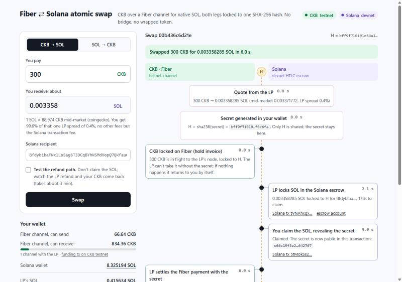
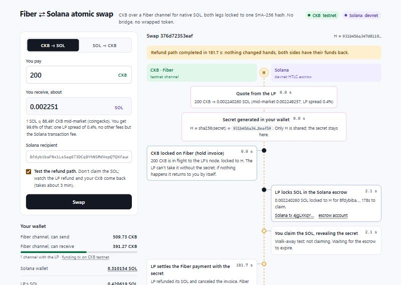

<!-- Draft for Nervos Talk. Before posting: upload the four screenshots in docs/img/ and replace the image paths; add the repo link where it says REPO. -->

# CKB ⇄ SOL in 5 seconds with no bridge: an atomic swap between Fiber and Solana (testnet demo)

**TL;DR.** I built a working proof of concept that swaps CKB for native SOL, and SOL for CKB, between a Fiber channel on **CKB testnet** and an escrow program on **Solana devnet**. Both legs are locked to one SHA-256 hash, so either both happen or neither does. There is no bridge, no wrapped token and no custodian. A swap takes 4–6 seconds. Both refund paths are tested on chain. It comes with a web UI, and everything needed to reproduce it is in the repo (REPO).



## Why this and not a bridge

There is no CKB → Solana route today. A bridge can move CKB *itself* to Solana as a wrapped token, but it can never hand you SOL: only Solana's own issuance creates SOL. To end up with SOL somebody has to sell it to you, so "CKB in, SOL out" is always a swap.

Fiber makes that swap cheap to do trustlessly, because a Fiber payment is already a hash time-locked contract. If the same hash locks SOL in an escrow on Solana, the two payments become one atomic trade:

- **One market maker, one spread.** No DEX hop, no hub fee, no BTC price exposure.
- **No new trust.** Nobody holds your funds. The worst a counterparty can do is make you wait for a timeout.
- **Fast.** Nothing waits for block confirmations on CKB; the CKB leg is off-chain.

## Architecture

```
            CKB testnet                                              Solana devnet
   ┌────────────────────────────┐                          ┌──────────────────────────────┐
   │  Fiber channel (on-chain   │                          │  HTLC escrow program         │
   │  funding cell, 1000 CKB)   │                          │  Lock / Claim / Refund /     │
   └──────────┬─────────────────┘                          │  Cancel, SHA-256 hash lock   │
              │ off-chain TLCs                             └───────────────┬──────────────┘
   ┌──────────┴──────────┐      Fiber payment on H      ┌──────────────────┴─────────────┐
   │ User's Fiber node   │◄────────────────────────────►│ LP's Fiber node                │
   │ (fnn v0.9.1)        │                              │ (fnn v0.9.1)                   │
   └──────────┬──────────┘                              └──────────────────┬─────────────┘
              │ JSON-RPC                                                   │ JSON-RPC
   ┌──────────┴──────────┐   quote, invoice, status     ┌──────────────────┴─────────────┐
   │ Wallet backend      │◄────────────────────────────►│ LP daemon (lp-fiber.mjs)       │
   │ (wallet.mjs)        │         (HTTP)               │ prices, hold invoices,         │
   │ holds the secret,   │                              │ locks / claims / refunds SOL   │
   │ claims / locks SOL  │                              └────────────────────────────────┘
   └──────────┬──────────┘
              │
        Web UI (browser)
```

Three pieces of new code, everything else is stock:

| Piece | What it is | Size |
|---|---|---|
| `solana/htlc` | Solana program: SOL escrow locked to a SHA-256 hash with an expiry | ~300 lines of Rust, 39 KB on chain |
| `lnroute/lp-fiber.mjs` | The liquidity provider: quotes a price, issues Fiber hold invoices, locks and claims SOL | ~250 lines |
| `lnroute/wallet.mjs` + `ui/` | The user's side: generates the secret, pays over Fiber, claims SOL; serves the web UI | ~300 lines + one HTML file |

Fiber is used unmodified (v0.9.1 release binary). The features that make this possible are already in it: **hold invoices** (`new_invoice` with a `payment_hash` and no preimage, then `settle_invoice` / `cancel_invoice`), **SHA-256 as the invoice hash algorithm**, and **`get_payment` returning the preimage** to the payer.

## The protocol

`H = sha256(secret)`. Every lock on both chains opens with the same secret.

### CKB → SOL (the user holds the secret)

```
 User wallet              User Fiber node        LP Fiber node            LP daemon              Solana
     │  secret, H = sha256(secret)                                           │                      │
     │── quote? ────────────────────────────────────────────────────────────►│                      │
     │◄─ 300 CKB → 0.003358 SOL, hold invoice on H ──────────────────────────│                      │
     │── pay invoice ──►│── TLC(300 CKB, H) ───►│  held, not settled         │                      │
     │                  │                       │── invoice "Received" ─────►│                      │
     │                  │                       │                            │── Lock(H, user, SOL)►│
     │── sees escrow: right claimer, amount, time left ──────────────────────────────────────────── │
     │── Claim(secret) ────────────────────────────────────────────────────────────────────────────►│  SOL → user
     │                  │                       │                            │◄─ reads secret ──────│
     │                  │◄── settled ───────────│◄── settle_invoice(secret) ─│                      │
     │                  │   CKB → LP            │                            │                      │
```

### SOL → CKB (the user's Fiber node holds the secret)

```
 User wallet              User Fiber node        LP Fiber node            LP daemon              Solana
     │── quote? ────────────────────────────────────────────────────────────►│                      │
     │── new_invoice ──►│  (node picks secret, H)                            │                      │
     │── invoice + H ───────────────────────────────────────────────────────►│                      │
     │── Lock(H, LP, SOL, long expiry) ────────────────────────────────────────────────────────────►│
     │                  │                       │                            │◄─ sees escrow ───────│
     │                  │◄── TLC(CKB, H) ───────│◄── send_payment ───────────│                      │
     │                  │── reveals secret ────►│── payment_preimage ───────►│                      │
     │                  │   CKB → user          │                            │── Claim(secret) ────►│  SOL → LP
```

### What happens when someone stops

| Situation | Outcome | Tested |
|---|---|---|
| CKB → SOL, user never claims | Escrow expires, LP refunds its SOL and cancels the hold invoice. The Fiber payment fails back with `InvoiceCancelled`; the user's CKB returns in full. | Yes, 181.7 s with a 180 s escrow |
| CKB → SOL, LP never locks SOL | Nothing to claim, so the secret is never revealed. The CKB returns when the invoice is canceled or the TLC times out. | By construction |
| SOL → CKB, LP's Fiber payment fails | LP signs `Cancel` on the escrow, which returns the SOL to the user immediately. | Yes, 10.7 s |
| SOL → CKB, LP never pays | The user refunds the SOL when the escrow expires. | Escrow refund tested separately |

### Timelocks

The rule is the usual one: whoever knows the secret must have their *incoming* leg expire before their *outgoing* leg, so they can't take one side and refund the other.

| Direction | Fiber TLC | Solana escrow | Check |
|---|---|---|---|
| CKB → SOL | user → LP, capped at **6 h 40 min** by the wallet | LP → user, **3 min** in the demo | LP refuses to lock SOL unless the held TLC outlives the escrow by ≥ 1 h |
| SOL → CKB | LP → user, capped at **6 h 40 min** by the LP | user → LP, **7 h 05 min** | LP refuses to pay unless the escrow outlives its TLC by ≥ 20 min |

## Results on testnet

Fiber v0.9.1, two nodes on CKB testnet, one channel funded on chain ([funding tx](https://testnet.explorer.nervos.org/transaction/0x3d695ebf15d3908795618cf3a50a69bdb8be3e57f93fbb66c4bc5dd5ea37db5b)). Solana program [`3NYcyDEL…xX9m`](https://explorer.solana.com/address/3NYcyDELHRt1Jr7A8APqPjYqr9bUDTZdo7pq4dqsxX9m?cluster=devnet) on devnet. Prices are live mid-market (CoinGecko) minus a 0.4% LP spread.

| Run | Paid | Received | Time | Solana transactions |
|---|---|---|---|---|
| CKB → SOL | 500 CKB | 0.005601632 SOL | 4.4 s | [lock](https://explorer.solana.com/tx/3HrniRujUZDdxc3JytURBFTPGkuJPL1WNTYofRtQisWThsnrUSBmG5jtwf3pkEjSd4aZAiQhEfZfABztxWB3VSTe?cluster=devnet), [claim](https://explorer.solana.com/tx/3s3NY6Mc6LgT1e1qTYgJSSQhUnYZ57Bf6BTh4JE3HeqYE7YFJhD1ZpNL8JcdhsXv1P4YjhAgTtxox4sAr4kC1H5M?cluster=devnet) |
| SOL → CKB | 0.003 SOL | 265.6411344 CKB | 5.0 s | [lock](https://explorer.solana.com/tx/GoS1VJqqSyUwzxcoSHebX7HojHtJb3c1dt2jt4CGJ2XzjPU47sdpjqyc16qekRoRyp6vnhZWrBRuEWm3CjXhJM3?cluster=devnet), [claim](https://explorer.solana.com/tx/2obBou1CdrtcPVDKyqfz5NC4kGcyymC5JW2AcrdKMc3K2XgSX8ApePJLHG6gYhaTaEAdxQedo5UEVtNt3N222Ce1?cluster=devnet) |
| CKB → SOL (from the web UI) | 300 CKB | 0.003358285 SOL | 6.0 s | [lock](https://explorer.solana.com/tx/tVNAhxqxnqdvfRLLAkD3AALx9ciwp7AfqnY14n95KHDCgKHqgyf7A34TmDDQMQoWCmWZ4UDhhazCMwvVJQYF5D3?cluster=devnet), [claim](https://explorer.solana.com/tx/5tMokSs2sJjdLhFFd4RjjRpBLHbik1vUkSHPd8amXaNUQUCEbeegcYf2WYAvKnGXy8MVfhMuyLT1SyXwsc355jKj?cluster=devnet) |
| SOL → CKB (from the web UI) | 0.005 SOL | 443.09043222 CKB | 4.4 s | [lock](https://explorer.solana.com/tx/5b3t125tSx27E1z8G7roni4gWgSeUs7ookwb14J5o4rHKRukVNJWS1YSPGDtSeXfQs7xaMGYmfy6yEh4YHBG4YxJ?cluster=devnet), [claim](https://explorer.solana.com/tx/5iFEYrLCtRprbCn3tpvtdDSveyVrhhqcUj9D7hRncP2XsXiodLRD7aSvhEfYwNWzPaSQo1eR2FEskwRp3DfH5RQK?cluster=devnet) |
| CKB → SOL, user walks away | 200 CKB | refunded | 181.7 s | [lock](https://explorer.solana.com/tx/4jgLXKqYt9RDprZsXRP7hdmJoZF5Eu4nKGRjXb1UALVsCW6B53sc311SS52GH2KdL7hFmMUTHDN21kbxv4xem6iw?cluster=devnet), [LP refund](https://explorer.solana.com/tx/2S4k7mnYWuR6VuGa2ujVqfXn1vCvGoP3Jdx7LZGA4qSBpSDigAetJ8DzeWqyyCTJf3FZM3sMCU31jzWxm2qxZgNM?cluster=devnet) |
| SOL → CKB, invoice withdrawn | 0.002 SOL | refunded | 10.7 s | [lock](https://explorer.solana.com/tx/4R8sbeW7qmXGwmUGvexf9AojHRH6xgFywfxxqpF59p6Z4Qn5F6sGgpBCDjCPVcpJipVq4eKVtyxvFGacGfsb2GBd?cluster=devnet), [LP cancel](https://explorer.solana.com/tx/5vQRta3kgcUYUecwoaCnHbgcVaAW1fn3CWTPD4EouX7pyKaMQdWGUdvvSKN72krbJbSw8EnCPL3Yhzx56wAfh6qx?cluster=devnet) |

The CKB leg leaves no on-chain trace per swap; that is the point of a payment channel. What is on CKB testnet is the channel's funding transaction.

The escrow program has 2 host tests and an on-chain check script that passes on devnet: lock, claim, refund and cancel, reading the secret back from the claim transaction, and 11 rejected calls (wrong secret, the hash used as the secret, wrong recipient, early refund, late claim, cancel by someone other than the claimer, and so on). Costs: lock ≈ 8.7k–13k compute units, claim 2.8k, refund 0.95k, cancel 1.2k.



## What it would cost on mainnet

Prices on 2026-11-12: CKB $0.000954, SOL $84.84, so 100,000 CKB ≈ 1.1244 SOL at mid-market.

| Route | Fees | SOL for 100,000 CKB |
|---|---|---|
| SimpleSwap (live floating quote) | ≈ 1.5% below mid | 1.1071 |
| This design with an LP charging 0.4% | one spread; Solana fee ≈ $0.0004; no CKB transaction per swap | ≈ 1.1199 |

So about **1.1–1.2% more SOL** than a centralized instant exchange, and non-custodial. That number is only as good as the assumption that an LP is willing to quote 0.4%. The spread is a parameter, not a measurement: a real LP prices in inventory risk, rebalancing cost and the capital it locks up while a swap is open.

## Things I learned about Fiber that others building on it may want to know

1. **Hold invoices work on testnet today** (v0.9.1). `new_invoice` with `payment_hash` + `hash_algorithm: "sha256"`, then `settle_invoice` with the preimage. `cancel_invoice` on a `Received` hold invoice fails the payment back to the payer with `InvoiceCancelled`.
2. **TLC expiry is randomized, and it is long unless you cap it.** For a single-hop payment to an invoice whose final expiry delta is 160 minutes, I saw the held TLC expire in 50 h, 110 h and 146 h on three attempts. Passing `tlc_expiry_limit: 24000000` (ms) to `send_payment` gives exactly 6 h 40 min. Smaller values are rejected: `9600000` fails with "too small for random expiry reserve 14400000", and `14400000` finds no path. **Anyone building a cross-chain swap on Fiber has to set this limit**, otherwise the timelock ordering between the two chains cannot be guaranteed.
3. **The payer gets the preimage.** `get_payment` returns `payment_preimage` after a successful payment, which is what makes the SOL → CKB direction possible without any change to Fiber.
4. **The minimum final expiry delta is 160 minutes** in release builds (`MIN_TLC_EXPIRY_DELTA`). So the worst-case lock-up on a failed swap is hours, not minutes. The `Cancel` instruction on the Solana side (the claimer waives its claim) exists to hide that in the common failure case.
5. **Fiber's Cross-Chain Hub swaps wrapped BTC, not CKB**, and the mainnet config whitelists only USDI. I also ran the hub route end to end locally (Fiber → CCH → Lightning → SOL, 7 s, with a Lightning hold invoice on the same hash). It works, but it stacks three fee-takers and comes out about level with SimpleSwap. The direct route above is the one worth building.

## What is and isn't trust-minimized

**Holds without trusting anyone:**
- Neither side can end up with both assets. The secret is revealed only by taking the asset the other side locked.
- The user sees the exact amount locked for them before revealing anything, and checks the claimer, amount and time left on chain.
- The LP locks SOL only after the CKB is held; in the other direction it pays CKB only after the SOL is locked.

**Known limits and risks:**
- **Griefing by timeout.** A counterparty can make you wait: the user's CKB for up to 6 h 40 min, the user's SOL for up to about 7 h, the LP's SOL for the escrow lifetime. No funds are lost, but capital is idle. A production LP would price this in or require a small non-refundable fee.
- **Late claims are dangerous.** A claim transaction carries the secret even if it fails. If the user broadcasts a claim that lands after the escrow expired, the LP could read the secret, settle Fiber and keep both. The wallet refuses to claim with less than 60 s left; a production wallet needs a wider margin and fee bumping.
- **The user must be online** to claim within the escrow lifetime (CKB → SOL).
- **Inventory.** The LP needs SOL on Solana and CKB liquidity on Fiber, and has to rebalance. Swap size is bounded by channel capacity.
- **A new user has no SOL for the claim fee.** Claims are permissionless and can only pay the address recorded in the escrow, so any relayer can submit them; the demo wallet pays the fee itself.

**Demo simplifications:** one LP process with hot keys; the user's Fiber node and Solana key sit behind a local wallet backend rather than a browser wallet; the user has a direct channel to the LP (a routed multi-hop payment should work the same way, but I haven't tested it); testnet and devnet tokens only.

## How this fits with a bridge

I also have the other half working in the same repo: a ZK light client for CKB on Solana (SP1 proofs of Eaglesong PoW and CKB's epoch rules) that mints a wrapped CKB token on Solana from a deposit on CKB, and releases it back. The two are complementary:

- **Swap** when you want SOL. Fast and cheap, limited by the LP's inventory.
- **Bridge** when you want CKB itself on Solana. No inventory limit, slower, and it is what an LP would use to rebalance.

## Run it yourself

Requirements: WSL (or Linux), Node 22, the Solana CLI, some testnet CKB in two wallets, some devnet SOL.

```
scripts/lnroute-install.sh        # pinned fnn v0.9.1 (and the tools for the local Lightning route)
scripts/fiber-testnet-up.sh       # two Fiber nodes on CKB testnet (user :8227, LP :8237)
node lnroute/fiber-channel.mjs    # open the user → LP channel (one on-chain tx, about a minute)
scripts/htlc-test.sh all          # host tests + build the escrow program
scripts/htlc-devnet-deploy.sh     # deploy it to devnet, fund the LP
bash lnroute/demo.sh              # LP daemon + wallet backend + web UI on http://127.0.0.1:7080
```

## What I'd like feedback on

1. Is capping `tlc_expiry_limit` the intended way to get a deterministic TLC expiry, or is there a better knob?
2. Would the Fiber team consider a shorter minimum final expiry delta for direct (single-hop) payments? It sets the worst-case lock-up for every cross-chain swap.
3. Is anyone running, or planning to run, an LP on Fiber mainnet? The LP daemon here is small; the hard part is inventory and pricing, not code.
4. Interest in a CKB-side version of the same idea for other chains with SHA-256 HTLCs (the escrow is ~300 lines on Solana)?
